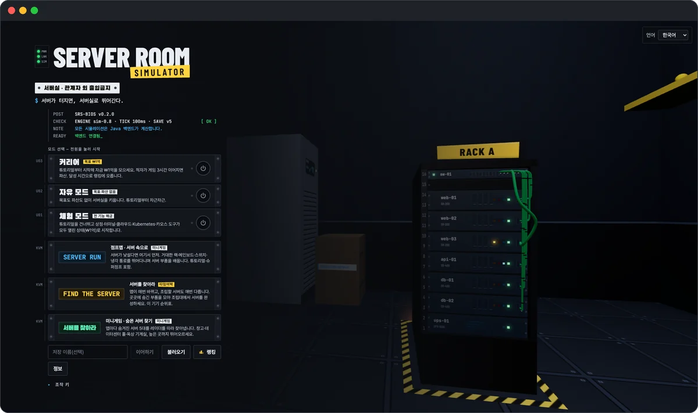
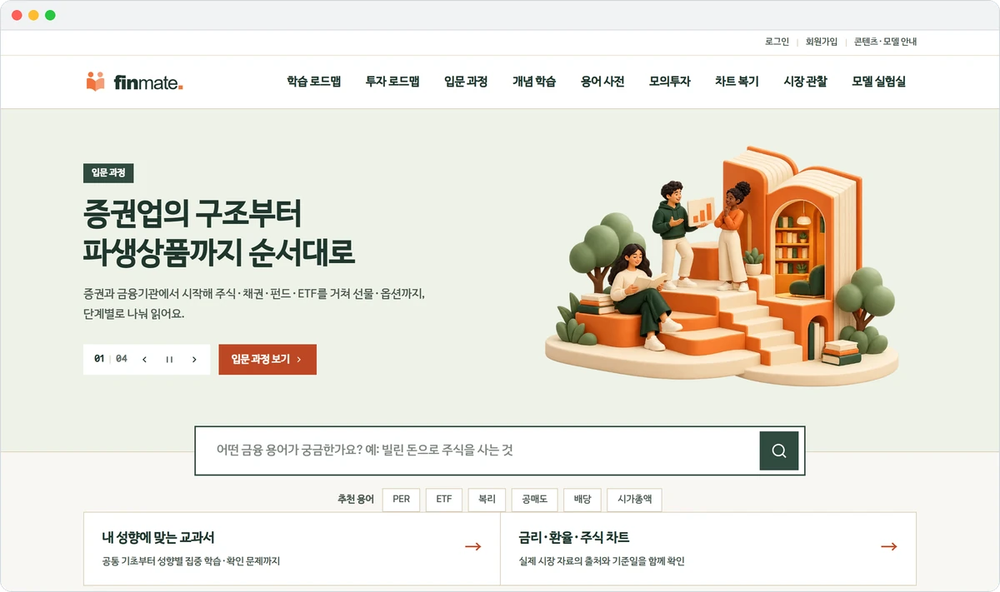

  <picture>
    <source media="(prefers-color-scheme: dark)" srcset="https://raw.githubusercontent.com/minkyu-k530/minkyu-k530/main/assets/header-dark.svg">
    
  </picture>

  
  
  

### Hi, I'm Minkyu.

I like building the whole thing: the screen, the server behind it, the database under it, and the cluster it runs on.

Lately that has meant a browser FPS, a server room simulator and a learning service for investing.

When a teammate gets stuck on an error, I want to be the person they ask first.

## What I care about

- **Servers that hold up.** Breaking things on purpose (outages, slow clients) to see what fails first.
- **Real time.** Game loops on a fixed tick, and live updates that never stall on one slow client.
- **The whole path.** React or three.js in front, Spring Boot and PostgreSQL behind, Docker and Kubernetes to ship it.

## Projects

  
  

| Project | What it is |
| --- | --- |
| **Server Room Simulator** | A 3D server room game where you live through power and disk failures. The server runs every rule in a 100 ms tick, and cutting the worst tick from **537 ms to 28.7 ms** with 100 players kept it there. |
| **SKALA FPS** | A fast browser FPS on three.js with no build step, made as a team. |
| **[FinMATE](https://github.com/oh-my-finance/omf-frontend)** | A learning service for investing, from how the market works to derivatives. Profile grades come from a rule engine, not an LLM. |
| **tradingBot** | An ETF trading bot on a broker's Open API. Limit orders only, a daily loss stop and a kill switch. |
| **PlantGuard AI** | Failure prediction for semiconductor equipment, built with a team of four. Trained on eight machines, it warns early on machines it has never seen. |

Projects without a link are not public.

<b>How the Server Room Simulator got under its tick budget</b>

 

Under a 15-second load test with 100 players, the worst tick took 537 ms, five times the 100 ms budget. Sending updates to clients happened on the tick thread, so one slow client held up the whole game. Moving those sends off the tick thread brought the worst tick down to 28.7 ms, with no tick over budget.

  <picture>
    <source media="(prefers-color-scheme: dark)" srcset="https://raw.githubusercontent.com/minkyu-k530/minkyu-k530/main/assets/srs-chart-dark.svg">
    
  </picture>

## Stack

  <picture>
    <source media="(prefers-color-scheme: dark)" srcset="https://skillicons.dev/icons?i=java%2Cspring%2Cpostgres%2Credis%2Cdocker%2Ckubernetes%2Cgithubactions%2Cgcp%2Cprometheus%2Cpython%2Cts%2Creact%2Cthreejs%2Cgit&theme=dark">
    
  </picture>

## Activity

  <picture>
    <source media="(prefers-color-scheme: dark)" srcset="https://raw.githubusercontent.com/minkyu-k530/minkyu-k530/output/calendar-dark.svg">
    
  </picture>

  <picture>
    <source media="(prefers-color-scheme: dark)" srcset="https://raw.githubusercontent.com/minkyu-k530/minkyu-k530/output/stats-dark.svg">
    
  </picture>
  <picture>
    <source media="(prefers-color-scheme: dark)" srcset="https://raw.githubusercontent.com/minkyu-k530/minkyu-k530/output/recent-dark.svg">
    
  </picture>

## About

- **Now** SK AI Leader Academy (SKALA), AI, cloud and MSA, July to December 2026
- **School** Myongji University, B.S. in Applied Software, August 2026
- **Certifications** Engineer Information Processing, Big Data Analysis Engineer, SQLD, ADsP
- **Awards**
  - Excellence Award, Cultureland pre-mission, 3rd of 100 (2026)
  - Best Award, business model competition for TrustBuilder, 1st of 27 (2026)
  - Best Active Participant Award, MJ Major Mentors (2025)
  - Excellence Award, Korean Tutoring, as team leader (2024)

 

The activity cards are redrawn every night by <a href="https://github.com/minkyu-k530/minkyu-k530/blob/main/.github/workflows/profile.yml">a GitHub Actions workflow</a>.
